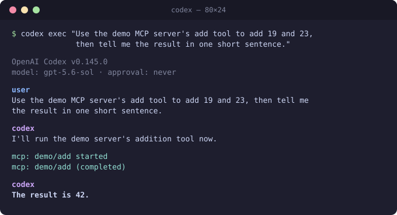

# Your First Conversation

What talking to an MCP client *actually looks like* — a complete
session between an AI agent and the
[demo server](../../source/apps/mcpdemo.pas), shown twice: as the
user saw it, and as your server saw it on the wire. The wire
transcript is Claude Code 2.1.332's, captured on 2026-11-27; the
terminal view and the classic handshake further down are from
2026-08-10, with the client releases current then.

## The user's view

The demo server was registered with the Codex CLI (v0.145.0) and
asked one question:



The agent decided on its own that the `add` tool fit the question,
called it, and used the answer. That's the whole consumer experience:
your tool became something the model reaches for.

Claude Code works the same way — register and check with:

```sh
claude mcp add demo /path/to/build/mcpdemo
claude mcp list        # → demo: … - ✔ Connected
```

## The same session on the wire

Claude Code 2.1.332 was asked to add 19 and 23 with the demo's `add`
tool. Five requests travelled over the server's stdin and stdout, all
at the stateless `2026-07-28` revision: there is no handshake, and
every request carries its own `_meta`. Everything below your handler's
one line of arithmetic was produced by the library. The client's
`_meta` is shown once and elided after that.

**1. The client asks what the server is** — `server/discover`, with
its identity and capabilities in `_meta`:

```json
{"jsonrpc":"2.0","id":"server-discover-probe-1","method":"server/discover","params":{
  "_meta":{"io.modelcontextprotocol/protocolVersion":"2026-07-28",
    "io.modelcontextprotocol/clientInfo":{"name":"claude-code","title":"Claude Code","version":"2.1.332","…":"…"},
    "io.modelcontextprotocol/clientCapabilities":{"roots":{"listChanged":true},"elicitation":{"form":{},"url":{}}}}}}
```

The server answers with the revisions it serves, its capabilities and
extensions, its identity and the `Instructions` you set — the text the
model reads to learn when to use your server:

```json
{"jsonrpc":"2.0","id":"server-discover-probe-1","result":{
  "supportedVersions":["2026-07-28"],
  "capabilities":{"tools":{},"resources":{},"prompts":{},"completions":{},"extensions":{"…":"…"}},
  "serverInfo":{"name":"pascal-mcp-sdk-demo","version":"0.1.0","…":"…"},
  "instructions":"Demo server for the pascal-mcp-sdk library. Use \"echo\" to mirror a message, \"add\" to add two numbers, \"pixel\" for a sample image; read mcp://pascal-mcp-sdk/greeting for a hello.",
  "ttlMs":300000,"cacheScope":"private","resultType":"complete","_meta":{"…":"…"}}}
```

**2. Discovery** — `prompts/list`, `resources/list` and `tools/list`,
and the client hands the catalog to the model. Note that your
`RegisterTool` call became a JSON Schema the model uses to shape its
arguments:

```json
{"jsonrpc":"2.0","id":2,"method":"tools/list","params":{"_meta":{"…":"…"}}}
```

```json
{"jsonrpc":"2.0","id":2,"result":{"tools":[
  {"name":"echo","description":"Echo a message back to the caller","inputSchema":{"…":"…"},"…":"…"},
  {"name":"add","description":"Add two numbers and return the sum",
   "inputSchema":{"type":"object",
     "properties":{"a":{"type":"number"},"b":{"type":"number"}},
     "required":["a","b"]},
   "outputSchema":{"type":"object","properties":{"sum":{"type":"number"}},"required":["sum"]},
   "…":"…"},
  "…"],"resultType":"complete","…":"…"}}
```

**3. The model calls your tool.** The arguments match the schema —
the library has already validated them before your handler runs:

```json
{"jsonrpc":"2.0","id":3,"method":"tools/call","params":{
  "name":"add","arguments":{"a":19,"b":23},"_meta":{"…":"…","progressToken":3}}}
```

**4. Your handler's result goes back** — human-readable `content`
plus the `structuredContent` matching the tool's output schema:

```json
{"jsonrpc":"2.0","id":3,"result":{
  "content":[{"type":"text","text":"The sum is 42"}],
  "isError":false,
  "structuredContent":{"sum":42},
  "resultType":"complete",
  "_meta":{"io.modelcontextprotocol/serverInfo":{"name":"pascal-mcp-sdk-demo","version":"0.1.0"}}}}
```

Then the model answered "42" — and when the session ended, the host
closed the server's stdin and the process exited. That
EOF-means-shutdown contract is why a pascal-mcp-sdk server needs no
signal handling and no restart loop.

## What a classic-handshake client sends

Clients that predate the stateless revision open with the classic
`initialize` handshake instead. Codex 0.145.0, captured on 2026-08-10:

```json
{"jsonrpc":"2.0","id":0,"method":"initialize","params":{
  "protocolVersion":"2025-06-18",
  "capabilities":{"elicitation":{"form":{},"url":{}}},
  "clientInfo":{"name":"codex-mcp-client","title":"Codex","version":"0.145.0"}}}
```

The server answers in that revision's dialect, and the client confirms
with `notifications/initialized` before its first request. Claude Code
2.1.226 still opened this way on 2026-08-10, at `2025-11-25`.
On stdio the library serves both: it speaks each classic revision it
supports (`2024-11-05`, `2025-06-18`, `2025-11-25`) *and* the
stateless `2026-07-28` revision, and picks per connection by how the
client opens — so as clients move to the stateless revision, your
server needs no change (see [Configuration](configuration.md#dualera)).
The Streamable HTTP binding serves `2026-07-28` only.

## The same conversation, stateless style

Under the `2026-07-28` revision there is no handshake at all — every
request is self-contained, carrying its `_meta`. You can hold this
conversation yourself from a shell:

```sh
./build/mcpdemo <<'EOF'
{"jsonrpc":"2.0","id":1,"method":"tools/call","params":{"name":"add","arguments":{"a":19,"b":23},"_meta":{"io.modelcontextprotocol/protocolVersion":"2026-07-28","io.modelcontextprotocol/clientCapabilities":{}}}}
EOF
```

One line in, one line out — same handler, same result, no protocol
session.
The [cookbook](cookbook.md#driving-it-all-by-hand) drives the whole
surface this way.

## Takeaways

- Your handler ran **once**, with validated typed arguments; the
  library produced every other byte on this page.
- Model-facing text matters: the tool `description` and the server
  `Instructions` are what made the model pick `add` unprompted.
- Clients move between protocol revisions at their own pace — the
  dual-era default on stdio absorbs that, so you never have to ask
  which client your users run.
