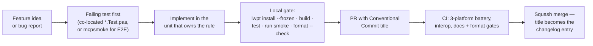

# Contributing Changes

> **Audience: contributors.** This is the one path every change takes
> — feature or fix, the steps are the same. Consumers only need the
> [guides](../guides/quick-start.md) and
> [reference](../reference/server.md) sections.

## Executive Summary

A change lands here by proving itself: a failing test first, the
implementation in the one unit that owns the rule, the local gate
(`lwpt install --frozen`, `lwpt build`, `lwpt test`, `lwpt run smoke`,
`lwpt format --check`) green, and a Conventional-Commit-titled PR through CI's
cross-platform and cross-implementation batteries. Features and fixes walk the same
path — a feature starts with a test specifying the behaviour, a fix
with a regression test that reproduces the bug.



## Set up once

- **FPC 3.2.2** — `apt install fpc` / `brew install fpc` / the
  win32+win64 combo installer from
  [freepascal.org](https://www.freepascal.org/download.html). The
  library targets **exactly 3.2.2**, with its compiler flags in
  `source/units/MCP.inc` (`fpc -iV` prints yours). CI's Windows leg
  installs 3.2.2 itself; the Linux and macOS legs take the package
  manager's FPC and print its version.
- **lwpt** — the canonical build/test/format entry point, at the
  release this repository pins: the exact `testing` version in
  `lwpt.toml` (`bash .github/scripts/lwpt-version.sh` prints it; a
  newer lwpt can refuse the committed lockfile). Download that
  release's tarball for your platform from
  [lwpt's releases](https://github.com/frostney/lwpt/releases),
  verify the checksum, put `lwpt` on PATH. Do not invoke `fpc`
  directly except as `fpc @lwpt.cfg`.
- **lefthook** — `lefthook install` once per clone wires the
  formatting pre-commit hook.
- **Node 24** — what CI uses; only for the interop harness
  (`tools/interop-ts/`), the conformance runner (`tools/conformance/`,
  at least 22) and the website (`website/`, whose Next.js needs at
  least 20.9).

Then:

```sh
git clone https://github.com/frostney/pascal-mcp-sdk
cd pascal-mcp-sdk
lwpt install --frozen  # verify lwpt.lock and the committed modules
lwpt build             # every [build] target in lwpt.toml (mcpdemo, mcpsmoke, mcpconformance)
lwpt test              # co-located unit suites
lwpt run smoke         # E2E battery: spawns mcpdemo and mcpconformance, drives the protocol
```

`lwpt install --frozen` is the CI mode: verify the lockfile and the
committed modules without touching the network — every PR matrix
leg (Linux, macOS, Windows) runs it.

## Start from a test

Every change starts with the test that would have caught it:

- **Fixing a bug?** Write the test that reproduces it — in the
  co-located suite of the unit that owns the behaviour
  (`source/units/MCP.<Area>.Test.pas`), or in `mcpsmoke` if it only
  shows up over a real transport. Watch it fail, then fix.
- **Adding a feature?** Write the test that specifies it. Test names
  state the rule being proven, spec-style
  (`'null id → -32600 (MCP forbids null ids)'`), so a failing run
  reads as a conformance report — see [Code Style](code-style.md).
- **Changing protocol behaviour?** The test cites the spec page it
  proves, and the implementation carries the citation + verification
  date. Spec facts are **verified, never recalled** — check the
  [schema anchor](https://github.com/modelcontextprotocol/modelcontextprotocol/blob/main/schema/2026-07-28/schema.ts)
  and a real client, not prose alone (see
  [Architecture § Spec grounding](architecture.md#spec-grounding)).

## Put the change where it belongs

Layering is strictly bottom-up, and each rule has exactly one home —
the ownership table in
[Architecture § Layering](architecture.md#layering) says which unit
owns what. The short version:

- Wire shape, id rules, error envelopes → `MCP.JSONRPC`.
- `_meta`, versioning, result stamping → `MCP.Protocol`.
- Dispatch, registries, sessions, error policy → `MCP.Server`.
- Schema building/derivation → `MCP.Schema`.
- Framing and byte movement → the transport units, which move lines
  only and never re-decide a protocol rule.

If a change seems to need protocol knowledge inside a transport (or
I/O inside the core), the design is wrong — re-read the layering
before writing code.

Three ground rules bound every change (the full set lives in
[AGENTS.md](../../AGENTS.md); the reasoning behind them is recorded in
the ADRs under
[docs/adr/](https://github.com/frostney/pascal-mcp-sdk/tree/main/docs/adr)):

- **FreePascal only** — FPC 3.2.2, Delphi mode, flags centralised in
  `MCP.inc`; no second compiled language, no per-unit directives.
- **Zero third-party runtime dependencies** — FPC-shipped packages
  only: RTL, fpjson, fcl-base (`base64`), and fcl-web confined to
  `MCP.Transport.HTTP`.
- **Public API changes update the reference docs** —
  `.github/scripts/check-reference-docs.sh` fails CI when an
  `MCP*`/`Register*` function or procedure declared in the interface
  of `MCP.Server.pas` or `MCP.Content.pas` is missing from
  `docs/reference/`. Public API in other units (and types, constants,
  properties) is not gated — document it by hand.

## Run the gate locally

```sh
lwpt install --frozen  # lockfile and committed modules agree
lwpt build             # every app compiles
lwpt test              # unit suites
lwpt run smoke         # E2E: mcpsmoke drives mcpdemo and mcpconformance over pipes
lwpt format --check    # formatter drift (pre-commit fixes in place)
lwpt health            # complexity within the manifest ceilings
lwpt duplication       # token clones within the manifest ceiling
```

While iterating, `lwpt test` takes selectors — a path or glob runs
just the suites you're working on
(`lwpt test source/units/MCP.Server.Test.pas`), and
`lwpt test --inventory` prints JSON with each selected test program's
path and its number of suites and cases. It starts every selected
program (compiling it unless a cached executable is current) to count
what it registers, and exits before any test body runs.

Protocol-surface changes should also run the interop battery — the
official MCP TypeScript clients against `mcpdemo`:

```sh
cd tools/interop-ts
npm ci
npm run interop
```

The official MCP conformance suite runs against the conformance
fixture (`mcpconformance --http`) and
is judged against the committed `tools/conformance/baseline.json`
(see [Tooling § Official conformance suite](tooling.md#official-conformance-suite--toolsconformance)).
A regression it reports is fixed, not recorded. The baseline changes in
the same PR only when a known failure or skip now passes, or a change
in what the suite can test is deliberate and tracked by an issue:

```sh
lwpt build
lwpt run conformance
```

Test *execution* touches no external network — pipes, loopback
sockets, and temp files only. The one exception is
`lwpt run conformance`, whose `npx` fetches the pinned suite from the
npm registry unless it is cached. Dependency *installation* is
separate: `npm ci` for the interop harness may reach the npm
registry.

## Open the PR

- **Title is a Conventional Commit** (`feat: …`, `fix: …`,
  `docs: …`). The repo squash-merges, so the title becomes the commit
  subject and the changelog entry — `pr-title.yml` gates it, with
  allowed types read from `cliff.toml`.
- CI must be green across the board. What runs
  (see [Tooling § CI](tooling.md#ci)):

| Gate | Proves |
| --- | --- |
| Linux / macOS / Windows legs | checksum-verified lwpt install, `install --frozen`, build, unit suites, mcpsmoke on every platform |
| `fpc @lwpt.cfg` leg | the zero-install path still works |
| `interop` (required) | the official TypeScript clients still talk to `mcpdemo` — a red interop job is a real cross-implementation regression |
| `conformance` (required) | the official conformance suite's 2026-07-28 requirement set, run against `mcpconformance`, still matches `tools/conformance/baseline.json` |
| format / agents `--check` | formatter and AGENTS.md command block have not drifted |
| `check-reference-docs.sh` | every `MCP*`/`Register*` routine in the interface of `MCP.Server` and `MCP.Content` is documented in `docs/reference/` |
| health / duplication | complexity and token-clone ceilings in `lwpt.toml` hold — ratchets set just above the adoption-day baseline, so they shrink but never grow unnoticed |
| markdownlint | docs follow `.markdownlint-cli2.jsonc` |
| pages.yml (on `docs/`/`website/` changes) | the website still builds; broken internal doc links fail here |

- Reverting via GitHub's Revert button produces a `Revert "..."`
  title git-cliff cannot parse — retitle it
  `revert: <original description>`.

[DEFINITION_OF_READY.md](../../DEFINITION_OF_READY.md) and
[DEFINITION_OF_DONE.md](../../DEFINITION_OF_DONE.md) define what makes
work startable and finished here.
